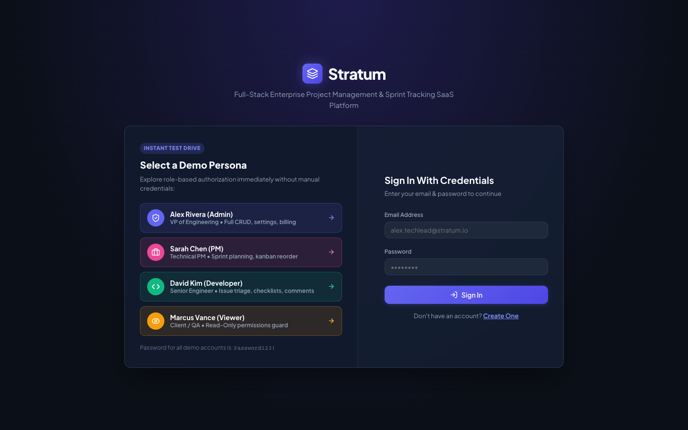
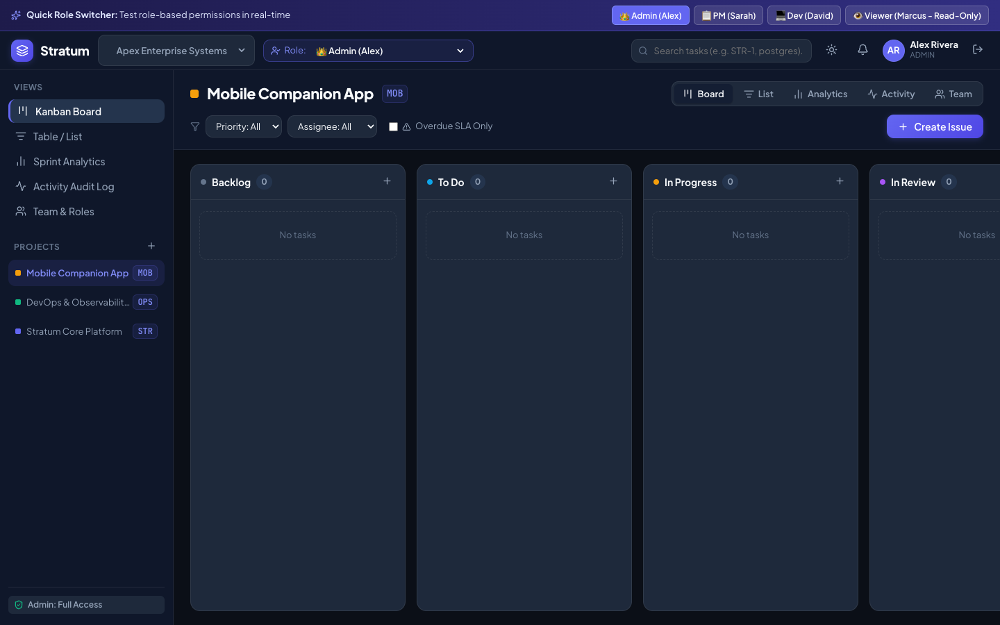
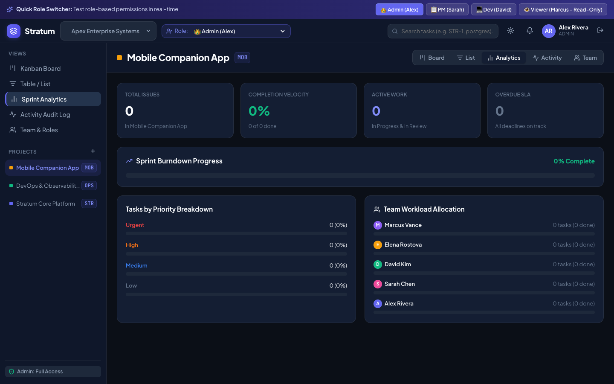
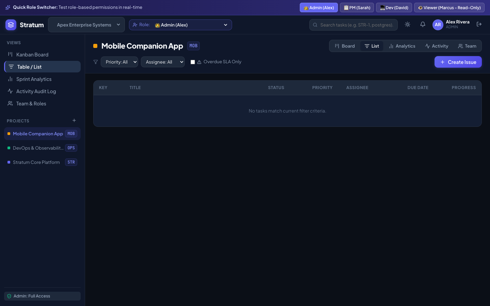

# Stratum — Full-Stack Project Management SaaS

[](https://github.com/arafatsheikh/project_01/actions)
[](https://www.djangoproject.com/)
[](https://react.dev/)
[](https://www.postgresql.org/)
[](https://www.docker.com/)
[](https://opensource.org/licenses/MIT)

> **Stratum** is an enterprise-grade, full-stack Project Management and Issue Tracking SaaS platform (a modern alternative to Jira and Trello). Built with **Django REST Framework**, **React**, **PostgreSQL**, and containerized with **Docker**, it features JWT-based role authorization, interactive drag-and-drop Kanban boards, sprint burndown velocity metrics, subtask checklists, in-app notifications, and audit logging.

---

## 📸 Visual Tour & Screenshots

| 1-Click Instant Persona Auth | Interactive Kanban Board |
| :---: | :---: |
|  |  |

| Sprint Analytics & Velocity Metrics | Filterable Project Tasks List View |
| :---: | :---: |
|  |  |

---

## 📚 Table of Contents

1. [Beginner Quickstart (Under 3 Minutes)](#-beginner-quickstart-under-3-minutes)
2. [Prerequisites & System Setup](#-prerequisites--system-setup)
3. [Step-by-Step Installation Guides](#-step-by-step-installation-guides)
   - [Method 1: Docker (Recommended)](#method-1-one-command-docker-setup-recommended)
   - [Method 2: Local Standalone Setup (Without Docker)](#method-2-local-standalone-setup-without-docker)
4. [Sample Accounts & Role Permissions Matrix](#-sample-accounts--role-permissions-matrix)
5. [User Guide: How to Use Stratum](#-user-guide-how-to-use-stratum)
   - [1. 1-Click Persona Login](#1-1-click-persona-login)
   - [2. Using the Kanban Board](#2-using-the-kanban-board)
   - [3. Creating Projects and Issues](#3-creating-projects-and-issues)
   - [4. Task Details, Checklists & Comments](#4-task-details-checklists--comments)
   - [5. Sprint Velocity & Burndown Analytics](#5-sprint-velocity--burndown-analytics)
   - [6. Notifications & Audit Trail](#6-notifications--audit-trail)
6. [Interactive API Explorer (Swagger & Redoc)](#-interactive-api-explorer-swagger--redoc)
7. [Running Automated Tests](#-running-automated-tests)
8. [Codebase & Architecture Tour](#-codebase--architecture-tour)
9. [Beginner Troubleshooting & FAQ](#-beginner-troubleshooting--faq)

---

## ⚡ Beginner Quickstart (Under 3 Minutes)

If you already have Python and Node.js installed, run these exact commands in your terminal:

### Terminal 1: Backend
```bash
# 1. Enter the project folder
cd project_01

# 2. Create and activate Python virtual environment
python3 -m venv backend/venv
source backend/venv/bin/activate       # On Windows: backend\venv\Scripts\activate

# 3. Install packages & initialize database
pip install -r backend/requirements.txt
python backend/manage.py migrate
python backend/manage.py seed_demo_data

# 4. Start backend server
python backend/manage.py runserver 8000
```

### Terminal 2: Frontend
```bash
# 1. Open a second terminal window in the project folder
cd project_01/frontend

# 2. Install dependencies & start web app
npm install
npm run dev
```

Now open your web browser and navigate to:
👉 **[http://localhost:5173](http://localhost:5173)**

Click on any persona card (such as **Alex Rivera (Admin)**) to immediately explore the system!

---

## 💻 Prerequisites & System Setup

Before you begin, verify what tools are installed on your computer.

### Check Existing Tools:
Open your terminal (macOS/Linux) or Command Prompt/PowerShell (Windows) and type:

```bash
git --version
python3 --version     # or 'python --version' on Windows
node --version
npm --version
docker --version      # optional, only needed if using Docker
```

### If anything is missing:
- **Git:** Download from [git-scm.com](https://git-scm.com/).
- **Python (v3.10, v3.11, v3.12, or v3.14):** Download from [python.org](https://www.python.org/downloads/). On Windows, remember to check the box **"Add Python to PATH"** during installation.
- **Node.js (v18, v20, or v22 LTS):** Download from [nodejs.org](https://nodejs.org/).
- **Docker Desktop (Optional):** Download from [docker.com](https://www.docker.com/products/docker-desktop/).

---

## 🛠️ Step-by-Step Installation Guides

### Method 1: One-Command Docker Setup (Recommended)

Docker packages PostgreSQL, the Django backend, and the React frontend into isolated containers. You do not need to install Python or Node manually.

1. **Start Docker Desktop** on your computer.
2. Open a terminal in this project root:
   ```bash
   cd project_01
   docker compose up --build
   ```
3. Docker will automatically:
   - Start a PostgreSQL 16 database container.
   - Wait for the database to become healthy.
   - Run database migrations (`migrate`).
   - Seed sample demo users, projects, and tasks (`seed_demo_data`).
   - Launch Gunicorn for the backend on port `8000`.
   - Compile the React frontend and serve it with Nginx on port `80`.
4. Open your browser:
   - **Frontend App:** [http://localhost:80](http://localhost:80)
   - **Backend API & Swagger Docs:** [http://localhost:8000/api/docs/](http://localhost:8000/api/docs/)
5. To stop the containers when finished:
   ```bash
   docker compose down
   ```

---

### Method 2: Local Standalone Setup (Without Docker)

This setup uses SQLite by default, which requires zero external database installation and runs instantly on macOS, Windows, and Linux.

#### Step 1: Set up the Backend (Django REST Framework)

1. Open your terminal and navigate to the project directory:
   ```bash
   cd project_01
   ```

2. Create a virtual environment:
   ```bash
   python3 -m venv backend/venv
   ```

3. Activate the virtual environment:
   - **macOS / Linux:**
     ```bash
     source backend/venv/bin/activate
     ```
   - **Windows (Command Prompt):**
     ```cmd
     backend\venv\Scripts\activate.bat
     ```
   - **Windows (PowerShell):**
     ```powershell
     backend\venv\Scripts\Activate.ps1
     ```

4. Install backend dependencies:
   ```bash
   pip install -r backend/requirements.txt
   ```

5. Apply database migrations:
   ```bash
   python backend/manage.py migrate
   ```

6. Seed the demo dataset:
   ```bash
   python backend/manage.py seed_demo_data
   ```
   > [!NOTE]
   > This command populates the database with 5 demo team members, 3 active projects (`STR`, `OPS`, `MOB`), 20+ realistic tasks, checklist items, audit logs, and in-app notifications.

7. Start the backend development server:
   ```bash
   python backend/manage.py runserver 8000
   ```
   Leave this terminal running. The backend API is now accessible at `http://127.0.0.1:8000/`.

---

#### Step 2: Set up the Frontend (React + Vite)

1. Open a **new** terminal window and navigate to the `frontend/` folder:
   ```bash
   cd project_01/frontend
   ```

2. Install Node packages:
   ```bash
   npm install
   ```

3. Start the Vite development server:
   ```bash
   npm run dev
   ```

4. Open your browser and navigate to:
   👉 **[http://localhost:5173](http://localhost:5173)**

---

## 👥 Sample Accounts & Role Permissions Matrix

Stratum implements an enterprise-grade **Role-Based Access Control (RBAC)** architecture.

### Sample Users

| Role | Name | Email | Password | What Can They Do? |
| :--- | :--- | :--- | :--- | :--- |
| **👑 Admin** | Alex Rivera | `alex.techlead@stratum.io` | `Password123!` | Full control: create projects, invite team members, edit all tasks, delete issues. |
| **📋 Project Manager** | Sarah Chen | `sarah.pm@stratum.io` | `Password123!` | Sprint lead: create projects, drag-and-drop tasks, assign issues, edit timelines. |
| **💻 Developer** | David Kim | `david.dev@stratum.io` | `Password123!` | Contributor: update task status, check off subtasks, leave comments, log hours. |
| **💻 Frontend Dev** | Elena Rostova | `elena.frontend@stratum.io` | `Password123!` | Contributor: work on UI components, drag cards to In Progress/Review. |
| **👁️ Viewer** | Marcus Vance | `marcus.qa@stratum.io` | `Password123!` | Read-Only stakeholder: inspect boards and view analytics. Blocked from modifying data (`403 Forbidden`). |

### Permissions Matrix

| Feature / Action | Admin | Project Manager | Developer | Viewer |
| :--- | :---: | :---: | :---: | :---: |
| **View Boards, Lists & Analytics** | ✅ | ✅ | ✅ | ✅ |
| **Drag & Drop Task Status** | ✅ | ✅ | ✅ | ❌ *(Disabled)* |
| **Create New Tasks** | ✅ | ✅ | ✅ | ❌ *(Disabled)* |
| **Edit Task Details / Due Dates** | ✅ | ✅ | ✅ | ❌ *(Disabled)* |
| **Toggle Checklist Items** | ✅ | ✅ | ✅ | ❌ *(Disabled)* |
| **Add Comments** | ✅ | ✅ | ✅ | ✅ |
| **Create New Projects** | ✅ | ✅ | ❌ | ❌ *(Disabled)* |
| **Invite Workspace Members** | ✅ | ❌ | ❌ | ❌ *(Disabled)* |
| **Delete Tasks** | ✅ | ❌ | ❌ | ❌ *(Disabled)* |

---

## 🧭 User Guide: How to Use Stratum

### 1. 1-Click Persona Login
When you open [http://localhost:5173](http://localhost:5173):
- You will see the **Instant Test Drive** panel on the left with 4 persona cards.
- Simply click **Alex Rivera (Admin)** or **David Kim (Developer)** to log in instantly without typing passwords.
- You can also switch roles at any time using the **top banner** or the **Role dropdown** in the navigation bar.

### 2. Using the Kanban Board
The main board organizes issues across 5 agile lifecycle stages:
- **📥 Backlog:** Items planned for future sprints.
- **📝 To Do:** Sprint tasks ready for implementation.
- **⚡ In Progress:** Tasks currently being developed.
- **🔍 In Review:** Code reviews, PRs, and QA validation.
- **✅ Done:** Finished and accepted tasks.

**Drag and Drop:**
- Click and hold any task card to drag it across columns (e.g., from `To Do` to `In Progress`).
- Release the card to drop it. The UI updates instantly (optimistic update) and syncs with the `/api/tasks/{id}/reorder/` backend API.

### 3. Creating Projects and Issues
- **Create an Issue:** Click the blue **"+ Create Issue"** button in the filter header (or the `+` icon on any Kanban column). Fill in the title, priority, assignee, due date, and tags, then click **Create Task**.
- **Create a Project:** In the left sidebar, click the `+` icon next to **Projects** (available for Admin and PM). Enter a project name and key prefix (e.g. `API`), pick an accent color, and submit.

### 4. Task Details, Checklists & Comments
Click any task card to open the **Task Detail Modal**:
- **Checklist:** View subtasks with a visual progress bar. Check off items as you finish them or type a new item and click **Add**.
- **Comments:** View team discussion history. Type a comment and press **Post Comment** to append to the task activity stream.
- **Properties:** Update status, priority (`Urgent`, `High`, `Medium`, `Low`), assignee, due date, and log estimated vs. actual hours.
- **SLA Deadline Badges:** If a task's due date has passed, an amber/red **Overdue** badge flashes automatically.

### 5. Sprint Velocity & Burndown Analytics
Click the **"Analytics"** tab in the navigation bar to inspect:
- **Total Issues & Completion Percentage:** Live sprint burndown progress bar.
- **Priority Distribution:** Percentage breakdown of Urgent, High, Medium, and Low tasks.
- **Team Workload Allocation:** Visual bar charts showing task distribution across team members.

### 6. Notifications & Audit Trail
- **Notifications:** Click the bell icon in the top right. You will see real-time alerts when tasks are assigned to you, status changes occur, or deadlines approach. Click **Mark all read** to clear badges.
- **Audit Log:** Click the **"Activity"** view in the sidebar to inspect a chronological audit log of all workspace events (e.g. *"Sarah Chen moved STR-3 to In Progress"*).

---

## 📖 Interactive API Explorer (Swagger & Redoc)

The backend exposes an interactive OpenAPI 3.0 specification generated by `drf-spectacular`. You can inspect endpoints, view request/response schemas, and test API calls directly in the browser:

- **Swagger UI:** [http://127.0.0.1:8000/api/docs/](http://127.0.0.1:8000/api/docs/)
- **Redoc Viewer:** [http://127.0.0.1:8000/api/redoc/](http://127.0.0.1:8000/api/redoc/)
- **Raw OpenAPI Schema:** [http://127.0.0.1:8000/api/schema/](http://127.0.0.1:8000/api/schema/)

### Core REST Endpoints Reference

| Method | Endpoint | Description |
| :--- | :--- | :--- |
| `POST` | `/api/auth/login/` | Obtain JWT access and refresh token pair |
| `POST` | `/api/auth/demo-login/` | 1-Click login endpoint (`role`: ADMIN, PM, DEV, VIEWER) |
| `GET` | `/api/auth/demo-accounts/` | List preconfigured demo accounts and credentials |
| `GET` | `/api/auth/me/` | Get authenticated user profile |
| `GET, POST` | `/api/workspaces/` | List workspaces / create workspace |
| `GET, POST` | `/api/projects/` | List projects / create project |
| `GET` | `/api/projects/{id}/analytics/` | Sprint burndown velocity and priority breakdown |
| `GET, POST` | `/api/tasks/` | List filtered tasks / create new task |
| `POST` | `/api/tasks/{id}/reorder/` | Reorder task status and float position |
| `POST` | `/api/tasks/{id}/subtasks/` | Add checklist item to task |
| `PATCH` | `/api/tasks/{id}/subtasks/{sub_id}/` | Toggle checklist item completion status |
| `POST` | `/api/tasks/{id}/comments/` | Add comment to task |
| `GET` | `/api/notifications/` | List notifications with unread counter |
| `POST` | `/api/notifications/mark-all-read/` | Mark all user notifications as read |
| `GET` | `/api/activity/` | List workspace audit logs and history |

---

## 🧪 Running Automated Tests

Stratum includes automated unit and integration tests covering JWT auth, auto-incrementing Jira keys, Kanban reordering, checklists, and role permissions:

```bash
# Ensure your virtual environment is active
source backend/venv/bin/activate       # On Windows: backend\venv\Scripts\activate

# Run the test suite
python backend/manage.py test tests
```

### Expected Output:
```text
Found 10 test(s).
Creating test database for alias 'default'...
..........
----------------------------------------------------------------------
Ran 10 tests in 1.15s

OK
Destroying test database for alias 'default'...
```

---

## 📂 Codebase & Architecture Tour

```text
project_01/
├── .github/
│   └── workflows/
│       └── ci.yml             # GitHub Actions CI workflow (linting, tests, docker)
├── backend/
│   ├── apps/
│   │   ├── accounts/          # Custom User model, JWT authentication, demo switchers
│   │   ├── workspaces/        # Multi-tenancy, workspace memberships, and invitations
│   │   ├── projects/          # Projects, Jira-style keys (STR, OPS), burndown analytics
│   │   ├── tasks/             # Kanban issues, checklists, comments, float reordering
│   │   ├── activity/          # Audit log trail recording all team actions
│   │   ├── notifications/     # In-app notifications & read status management
│   │   └── common/            # Shared pagination, permissions, seed data command
│   ├── config/                # Django settings, root URLs, and OpenAPI configuration
│   ├── tests/                 # Automated APITestCase test suite
│   ├── Dockerfile             # Production container definition for Python/Django
│   ├── entrypoint.sh          # Auto-migration and database wait script
│   └── requirements.txt       # Frozen Python dependencies
├── frontend/
│   ├── src/
│   │   ├── components/        # KanbanBoard, TaskCard, ListView, Analytics, Modals
│   │   ├── context/           # AuthContext managing user session and role helpers
│   │   ├── services/          # API client with auto-refresh on 401
│   │   ├── App.jsx            # Main application layout and view router
│   │   ├── App.css            # Component-specific styles
│   │   └── index.css          # Design system tokens (CSS variables, dark/light theme)
│   ├── Dockerfile             # Multi-stage production container (Node build + Nginx)
│   ├── nginx.conf             # Nginx reverse proxy routing /api/ to backend
│   └── package.json           # Frontend dependencies
├── docker-compose.yml         # Multi-container orchestration (PostgreSQL + Backend + Frontend)
├── .env.example               # Environment variables template
└── README.md                  # Complete documentation
```

---

## ❓ Beginner Troubleshooting & FAQ

### Q1: "Port 8000 or 5173 is already in use"
Another application is already using that port.
- **On macOS / Linux:**
  ```bash
  lsof -ti:8000 | xargs kill -9
  lsof -ti:5173 | xargs kill -9
  ```
- **On Windows:**
  ```cmd
  netstat -ano | findstr :8000
  taskkill /PID <PID_NUMBER> /F
  ```
- Or run Django on a different port: `python backend/manage.py runserver 8080`.

### Q2: "Command not found: python3" (Windows)
On some Windows installations, the command is `python` instead of `python3`:
```cmd
python -m venv backend\venv
```

### Q3: "Cannot activate virtual environment in Windows PowerShell"
If PowerShell gives an execution policy error:
```powershell
Set-ExecutionPolicy -Scope Process -ExecutionPolicy Bypass
.\backend\venv\Scripts\Activate.ps1
```

### Q4: "How do I reset the database to a fresh state?"
If you ever want to wipe your local database and re-seed clean demo data:
```bash
rm backend/db.sqlite3
python backend/manage.py migrate
python backend/manage.py seed_demo_data
```

### Q5: "Network Error: Failed to fetch in frontend"
Make sure your backend server is running in Terminal 1 on port 8000. The frontend proxies `/api` calls to `http://127.0.0.1:8000`.

---

## 📄 License

Distributed under the MIT License. Built for software engineering portfolio and enterprise evaluation.
